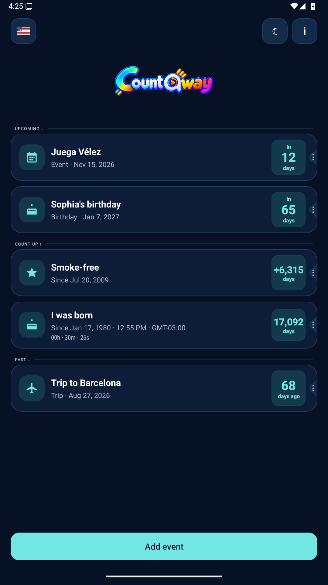
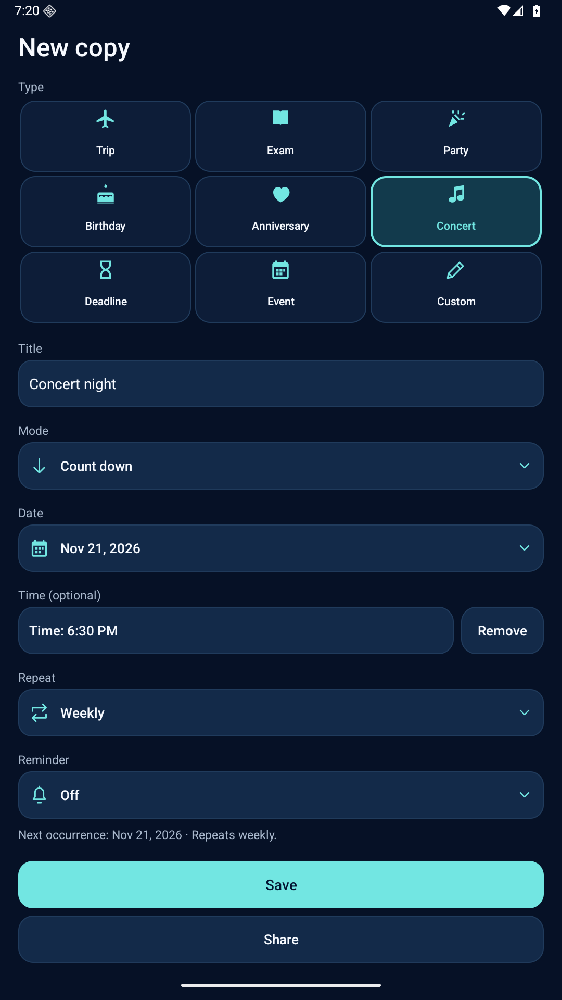
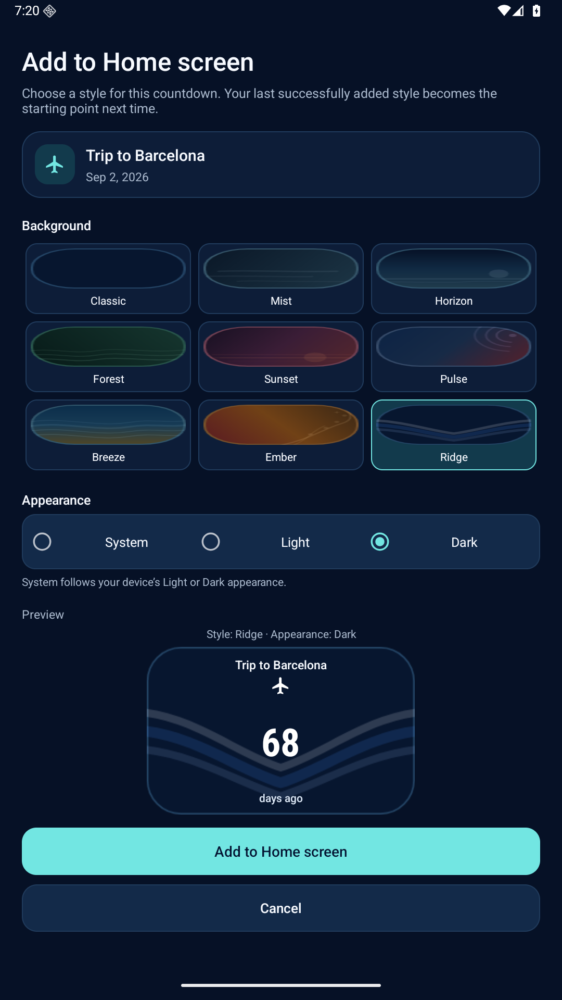
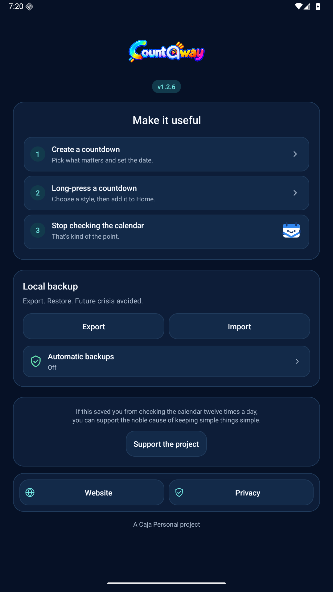
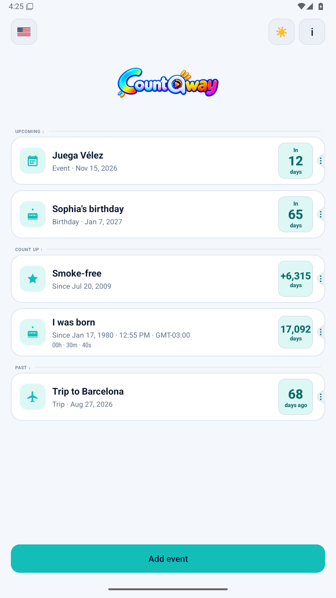
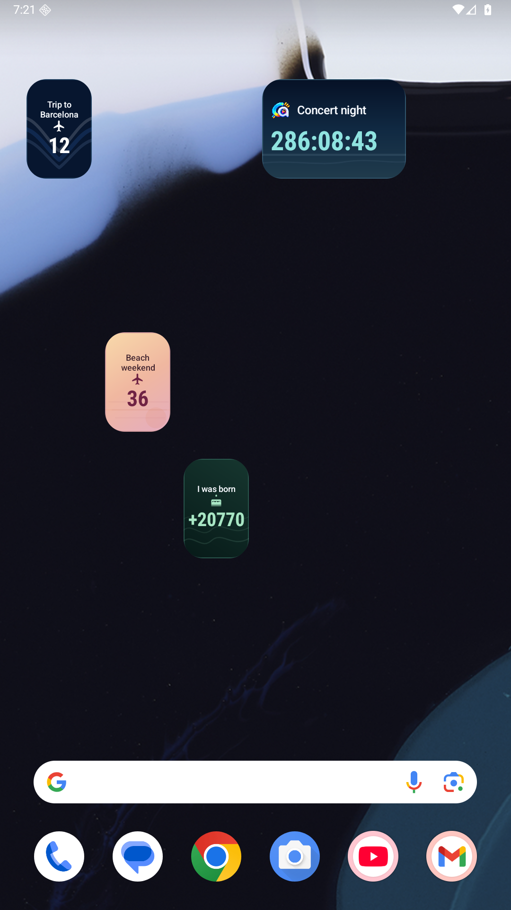

# CountAway

<p align="center">
  
</p>

<p align="center">
  <strong>A lightweight Android counter for dates worth looking forward to — or remembering.</strong>
</p>

<p align="center">
  Pick a date. Add a time if you want. Put it on your home screen. Get on with your life.
</p>

<p align="center">
  <a href="https://apps.obtainium.imranr.dev/redirect?r=obtainium://add/https://github.com/santirodriguez/CountAway"></a>
  &nbsp;&nbsp;
  <a href="https://f-droid.org/packages/com.santiagorodriguez.countaway/"></a>
  &nbsp;&nbsp;
  <a href="https://play.google.com/store/apps/details?id=com.santiagorodriguez.countaway"></a>
</p>


<p align="center">
  <a href="https://github.com/santirodriguez/CountAway/releases"></a>
  <a href="LICENSE"></a>
</p>

<p align="center">
  <sub>No accounts · no ads · no analytics · no cloud sync · no Internet permission</sub>
</p>

---

## The idea

I wanted a home-screen widget that simply showed how many days were left until something important.

Somehow, “count the days” often turns into an account, a subscription, a dashboard, and a minor career change.

CountAway skips all that. It counts the days and leaves you alone.

<table>
  <tr>
    <td width="33%" valign="top">
      <strong>Count what matters</strong><br /><br />
      Count down to future dates or count up from a starting date, with custom icons and optional times.
    </td>
    <td width="33%" valign="top">
      <strong>Keep it on Home</strong><br /><br />
      Classic day-count widgets, plus a dedicated live-hours widget for events with a time.
    </td>
    <td width="33%" valign="top">
      <strong>Keep it yours</strong><br /><br />
      Everything stays local. Backup and restore with JSON when <em>you</em> want portability. No dashboard required.
    </td>
  </tr>
</table>

## Highlights

- **Count both ways:** count down to future dates or count up from a start date.
- **Optional event times:** show live hours, minutes, and seconds; event clock labels follow your device's 12/24-hour setting.
- **Two kinds of widgets:** classic day-count widgets and a dedicated live-hours widget for timed events, with a compact 2×1 option on compatible launchers.
- **Widget-first:** long-press an event, choose a style, preview it, and add it to Home.
- **Flexible recurrence:** weekly, monthly, or yearly count-down events.
- **Nine widget backgrounds:** from clean Classic to Mist, Horizon, Sunset, Ember, Ridge, and more.
- **Three appearance modes:** System, Light, and Dark for both the app and widgets.
- **Useful reminders:** optional local notifications for count-down events.
- **Smart widgets:** fixed widgets support both directions; **Next countdown** follows the nearest upcoming count-down event.
- **Share without the screenshot ritual:** Send a Ridge-style PNG card, or full text for exceptionally long titles.
- **Local portability:** JSON export/import stays entirely under your control.
- **Multilingual:** English, Español, and Català.

## Screenshots

Six genuine CountAway 1.2.5 screenshots. Select any image to view it in full size.

<table>
<tr>
<td align="center" valign="bottom"><a href="fastlane/metadata/android/en-US/images/phoneScreenshots/1.png"></a></td>
<td align="center" valign="bottom"><a href="fastlane/metadata/android/en-US/images/phoneScreenshots/2.png"></a></td>
<td align="center" valign="bottom"><a href="fastlane/metadata/android/en-US/images/phoneScreenshots/3.png"></a></td>
<td align="center" valign="bottom"><a href="fastlane/metadata/android/en-US/images/phoneScreenshots/4.png"></a></td>
<td align="center" valign="bottom"><a href="fastlane/metadata/android/en-US/images/phoneScreenshots/5.png"></a></td>
<td align="center" valign="bottom"><a href="fastlane/metadata/android/en-US/images/phoneScreenshots/6.png"></a></td>
</tr>
<tr>
<td align="center"><strong>Home</strong></td>
<td align="center"><strong>Timed editor</strong></td>
<td align="center"><strong>Widget styles</strong></td>
<td align="center"><strong>About</strong></td>
<td align="center"><strong>Light mode</strong></td>
<td align="center"><strong>Home widgets</strong></td>
</tr>
</table>

<p align="center"><sub>Original CountAway 1.2.5 Android captures · Unmodified screenshot pixels</sub></p>

## Privacy, by design

CountAway has no Internet permission, accounts, ads, analytics, or cloud sync.

Your events stay on your device. Revolutionary stuff, apparently.

## Help improve CountAway

Found a confusing translation, a bug, or an idea worth sharing? See [how to contribute](CONTRIBUTING.md). You don't need Android experience to help with translations and feedback.

## Build

Requires **JDK 17** and **Android SDK 36**.

```bash
./gradlew test lint assembleDebug assembleDebugAndroidTest assembleRelease
```

Maintainer signing and release steps are in [`docs/RELEASING.md`](docs/RELEASING.md), with Google Play preparation in [`docs/PLAY.md`](docs/PLAY.md) and F-Droid notes in [`docs/FDROID.md`](docs/FDROID.md).

---

## Support CountAway

<p align="center">
  A <a href="https://cajapersonal.org/"><strong>Caja Personal</strong></a> project.<br />
  Free, open source, and focused on the dates that matter.
</p>

<p align="center">
  <a href="https://cajapersonal.org/donate/"></a>
</p>

<p align="center"><sub><a href="https://countaway.cajapersonal.org/">Website</a> · <a href="https://countaway.cajapersonal.org/privacy/">Privacy</a> · <a href="LICENSE">Apache License 2.0</a></sub></p>

## License

Licensed under the [Apache License 2.0](LICENSE).
